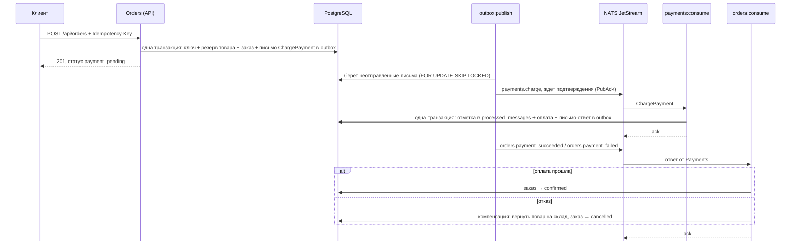

# orders-saga

Учебный сервис заказов и оплаты на Laravel. Показывает, как сделать надёжный процесс «заказ → оплата → подтверждение» в системе, где части общаются через брокер сообщений и любая из них может упасть в любой момент.

Главная идея: **гарантии держит база данных** (транзакции и уникальные индексы), без проверки `if exists` в коде.

**Стек:** PHP 8.5, Laravel 13, PostgreSQL 18, NATS JetStream, Pest, Docker (Laravel Sail).

## Что умеет

- `POST /api/orders` создаёт заказ и резервирует товар на складе.
- Повторный запрос с тем же `Idempotency-Key` не создаёт второй заказ, а возвращает сохранённый ответ.
- Сообщение об оплате не теряется, даже если брокер недоступен (transactional outbox).
- Повторно доставленное сообщение не списывает деньги дважды.
- Если оплата не прошла, товар возвращается на склад, а заказ отменяется (сага с компенсацией).

## Как проходит заказ



Статусы заказа: `payment_pending` → `confirmed` или `cancelled`. Оба конечные: из них перейти никуда нельзя, это проверяет `OrderStatus::canTransitionTo()`.

## Ключевые решения

| Проблема | Решение | Где в коде |
|---|---|---|
| Ответ потерялся в сети, клиент повторил запрос, и получилось два заказа | `Idempotency-Key`: ключ, заказ и сохранённый ответ пишутся в **одной транзакции**. Второй запрос с тем же ключом ждёт на уникальном индексе, потом отдаёт готовый ответ с заголовком `Idempotent-Replayed: true`. Тот же ключ с другим телом → 422 | `app/Http/Middleware/EnsureIdempotency.php`, `app/Services/RequestHasher.php` |
| Два покупателя одновременно берут последний товар | `SELECT ... FOR UPDATE` в транзакции; товары блокируются в порядке `id`, чтобы не было deadlock; `CHECK (stock >= 0)` в базе как последний рубеж | `app/Services/OrderService.php` |
| Заказ сохранён, а сообщение в брокер не ушло (dual write) | Transactional outbox: сообщение пишется в таблицу в той же транзакции, что и заказ. Отдельная команда отправляет его с повторами | `app/Services/Outbox.php`, `app/Console/Commands/PublishOutbox.php` |
| Отправка «отправил и забыл» может молча потерять сообщение | Публикация через `request()` с ожиданием подтверждения от JetStream (PubAck). Нет подтверждения → письмо остаётся в outbox, растёт `attempts` | `app/Messaging/NatsMessageBus.php` |
| Сообщение доставлено дважды (повтор почтальона или брокера) | `Nats-Msg-Id` отсекает быстрые повторы в брокере. Консьюмер первым шагом вставляет `(consumer, message_id)` в `processed_messages` в одной транзакции с бизнес-логикой; `ack` - после коммита | `app/Payments/ChargePaymentHandler.php`, `app/Orders/OrderSagaHandler.php` |
| Оплата не прошла, а товар уже зарезервирован | Компенсация: отдельное действие `stock = stock + quantity`, заказ → `cancelled` с причиной | `app/Orders/OrderSagaHandler.php` |
| Запоздалое сообщение пытается «воскресить» отменённый заказ | Проверка допустимости перехода статуса; недопустимый переход логируется и пропускается без исключения, чтобы сообщение не крутилось по кругу | `app/Enums/OrderStatus.php` |

Ещё по мелочи:

- Деньги хранятся в копейках (`bigint`), и API тоже отдаёт копейки: никаких float.
- В позиции заказа сохраняется снимок цены, а сумма считается на сервере по ценам из базы.
- Брокер спрятан за интерфейсом `MessageBus`: в тестах подменяется фейком, а NATS можно заменить на другой брокер одной строкой в `AppServiceProvider`.
- Слои: Form Request → readonly DTO → сервис → API Resource; контроллер только соединяет их.

## Запуск

Нужен Docker.

```bash
git clone https://github.com/tlegen99/orders-saga.git
cd orders-saga
cp .env.example .env

# установить зависимости без локального PHP
docker run --rm -u "$(id -u):$(id -g)" -v "$(pwd):/var/www/html" -w /var/www/html \
    laravelsail/php84-composer:latest composer install --ignore-platform-reqs

./vendor/bin/sail up -d
./vendor/bin/sail artisan key:generate
./vendor/bin/sail artisan migrate --seed   # 5 товаров с известными ценами
./vendor/bin/sail artisan nats:setup        # stream SAGA и консьюмеры payments / orders
```

Дальше нужны три фоновых процесса, каждый в своём терминале:

```bash
./vendor/bin/sail artisan outbox:publish     # отправляет письма из outbox в NATS
./vendor/bin/sail artisan payments:consume   # Payments: списывает деньги
./vendor/bin/sail artisan orders:consume     # Orders: подтверждает заказ или запускает компенсацию
```

## Проверка руками

Успешный заказ:

```bash
curl -s -X POST localhost/api/orders -H 'Content-Type: application/json' \
  -H "Idempotency-Key: demo-$(date +%s)" \
  -d '{"items":[{"product_id":1,"quantity":1}]}'
```

Ответ придёт со статусом `payment_pending`, а через пару секунд заказ станет `confirmed`.

Отказ оплаты: фейковый шлюз отклоняет суммы, которые заканчиваются на 13 рублей. Создайте товар за 1313 ₽ и закажите его:

```bash
./vendor/bin/sail artisan tinker --execute="dump(App\Models\Product::create(['name' => 'Test', 'price' => 131300, 'stock' => 10])->id);"
```

Заказ станет `cancelled`, а остаток товара вернётся к исходному.

Недоступность брокера: `sail stop nats`, создайте заказ. Письмо останется в `outbox_messages` с ошибкой в `last_error`. После `sail start nats` оно уйдёт.

## Тесты

```bash
./vendor/bin/sail artisan test
```

Тесты идут в отдельную PostgreSQL-базу `testing`, поэтому блокировки, CHECK-ограничения и `jsonb` работают так же, как в приложении. Что проверяется:

- создание заказа, нехватка товара (резерв откатывается целиком), несуществующий товар, валидация;
- идемпотентность: повтор, другое тело, другой порядок ключей в JSON, отсутствие ключа;
- outbox: письмо пишется вместе с заказом и не появляется при откате; публикация; брокер недоступен → письмо не теряется;
- консьюмер Payments: успех, отказ шлюза, повторное сообщение не создаёт вторую оплату;
- сага: подтверждение, компенсация, повторный отказ возвращает товар только один раз, запоздалый успех не меняет отменённый заказ.

Гонку двух одновременных запросов с одним ключом тестами не проверить: в тестах всё идёт в одном соединении с базой. Её проверял руками двумя параллельными `curl`: оба ответа с одним uuid, заказ один.

## Что осознанно упрощено

- Orders и Payments - модули одного приложения с общей базой; общаются только через NATS. Payments ради `order_id` читает таблицу `orders`; в отдельных сервисах у Payments была бы своя база.
- Платёжный шлюз фейковый. Uuid заказа уже передаётся в него как idempotency key, чтобы настоящий шлюз не списал деньги дважды при повторе.
- Сообщения обрабатываются по одному; служебные ответы JetStream без тела пропускаются. Сообщения, которые невозможно обработать, только логируются; на проде их стоит отправлять в отдельную очередь (DLQ).
- Статусы `pending` и `paid` пока не используются: это задел под будущие шаги, например доставку.

## Что дальше

- [ ] таймауты саги: отменять заказы, которые зависли в `payment_pending`;
- [ ] correlation id в логах и заголовках сообщений, чтобы проследить один заказ через все сервисы;
- [ ] очистка старых ключей идемпотентности (`MassPrunable`);
- [ ] `GET /api/orders` и фронт на Vue 3 + TypeScript + Pinia со статусами заказов.
